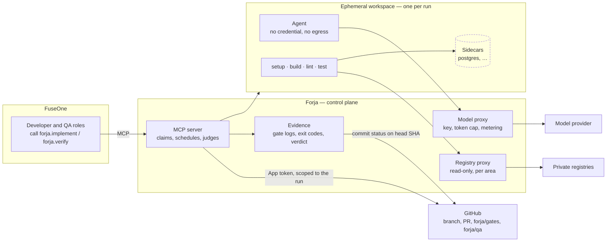

<div align="center">

<picture>
  <source media="(prefers-color-scheme: dark)" srcset="docs/assets/logo-wordmark-dark.svg">
  
</picture>

<p><strong>The execution runtime of the FuseOne software factory.</strong><br>
An MCP server that takes "implement issue X in repository Y" and returns a PR
with verifiable evidence:<br>the commands that ran, their exit codes, the raw
gate logs and whether the tests bite.</p>

<p>
  <a href="docs/PRD.pdf">PRD</a> ·
  <a href="https://github.com/fuseone-io/fuseone-forja/issues">Issues</a> ·
  <a href="CLAUDE.md">Engineering rules</a>
</p>

</div>

Forja does the one thing the FuseOne factory does not do today: it executes
code. FuseOne orchestrates roles over a board, approves writes, accounts for
cost and keeps the trail; its Developer role commits through the GitHub API
and its QA role reads CI instead of running tests. Forja gives those roles a
workspace: checkout, build, tests and support services in an ephemeral,
isolated environment that no person's machine is part of.

It is a control plane and nothing else. Orchestration, approval, budget and
merge policy stay in FuseOne, which registers Forja as one more MCP server and
classifies its tools in the Gate like any other.

**Status:** phase 0 is proposed, not approved. The repository holds the PRD,
the engineering rules and the backlog ([issues #1–#24](https://github.com/fuseone-io/fuseone-forja/issues)),
each a vertical slice with its blockers listed inline. The code starts with
the MCP server skeleton ([#5](https://github.com/fuseone-io/fuseone-forja/issues/5)).

## The shape of it



**Judgement stays outside the agent's reach.** The gate report, `forja/gates`
and `forja/qa` are produced by the control plane from exit codes it observed
and published as commit statuses on the head SHA. The agent in the workspace
cannot forge a green gate, cannot push and holds no credential.

**The contract is read from the base commit.** `.forja.yaml` is loaded from
the base branch's commit, never from the agent's tree, and that SHA is pinned
in the evidence. A change the agent makes to the contract, the Makefile, the
scripts or an existing test does not go unnoticed: it opens the "proof
apparatus" section of the evidence and sends the PR to a human merge.

## What it will do in phase 0

- Onboard any repository that declares a `.forja.yaml` contract, with no
  area-specific code in Forja. `forja.doctor` runs the contract against `main`
  and refuses to onboard while any gate fails there.
- Run `forja.implement`: reserve the issue, build the workspace from the
  contract's image and services, run the agent with the issue and the
  repository's `agent_context`, run the gates on the agent's tree, retry on red
  up to a limit, and on green push a branch, open the PR with the evidence and
  publish `forja/gates`.
- Run `forja.verify`: a QA agent inverts the change — the half a real
  regression would undo and the complement of what the developer declared
  testing — and the gates must go red. Verdicts: bites, does not bite, not
  verifiable. Never a green `forja/qa` for a diff with nothing to invert.
- Report per run: compute minutes, agent tokens, every command and exit code,
  denied egress events.
- Keep nothing: one workspace per run, destroyed at the end, no shared volume
  between runs or repositories.

## The contract

The `.forja.yaml` at the repository root is the only thing an area writes to
onboard. It declares how the repository builds and proves itself; Forja
guesses nothing.

```yaml
version: 1
image: golang:1.24
setup:
  - make deps
services:
  postgres: { image: postgres:17, env: { POSTGRES_PASSWORD: test } }
registries:
  - ghcr.io/my-org
gates:                       # order matters; every one must exit 0
  - name: build
    run: make build
  - name: lint
    run: make lint
  - name: test
    run: make test
  - name: integration
    run: make integration-test
    needs: [postgres]
verify:
  exclude: ["**/*.md", "migrations/**"]
proof_paths:                 # a change here is visible and asks for a human merge
  - .forja.yaml
  - Makefile
  - scripts/**
  - "**/*_test.go"
human_merge_paths:
  - .github/**
limits:
  wall_clock: 30m
  max_diff_lines: 400
agent_context:
  - CLAUDE.md
  - CONTRIBUTING.md
```

Gates are the repository's own commands. Forja reads the exit code and keeps
the raw log; it never interprets test output.

## The tools

| Tool | Gate class | Caller | Effect |
| --- | --- | --- | --- |
| `forja.doctor` | read | maintainer, Triage | runs the contract on `main`, no push |
| `forja.plan` | read | Developer | checkout and `agent_context`; returns what the agent will see |
| `forja.implement` | write | Developer | branch, commits, gates and a PR with `forja/gates` |
| `forja.verify` | write | QA | QA agent, inversions and gates; publishes `forja/qa` |
| `forja.status` | read | any role | state, log and cost of a run |

`implement` and `verify` are writes: in copilot mode they wait for a person
like any other write. An area that wants autonomy decides that in FuseOne,
not in Forja.

## Isolation

The agent is untrusted code: it reads issues and PRs written by people and
executes what the repository tells it to. Isolation belongs to the runtime,
never to a rule in a prompt.

- One workspace per run. Container or microVM, destroyed at the end.
- No credential in the workspace. Checkout, push and PR use the GitHub App
  token in the control plane, scoped to the repository and the run.
- The model and private registries are reached only through proxies in the
  control plane, which hold the keys, cap tokens and meter cost.
- Egress only to the proxies. Everything else is denied and logged.
- Push only to the run's own branch. The App has no bypass; `main`'s protection
  keeps applying.
- One run per issue, reserved atomically under `refs/forja/claims/<n>` with a
  lease that expires.

Whether the workspace is a gVisor container or a Firecracker microVM, and
whether Forja runs beside FuseOne or in a dedicated pool, are phase 0
decisions still open ([#3](https://github.com/fuseone-io/fuseone-forja/issues/3)).
So is the agent that runs inside it ([#2](https://github.com/fuseone-io/fuseone-forja/issues/2)).

## Running it locally

Prerequisites: Go 1.25 or later and [golangci-lint](https://golangci-lint.run)
v2.15.0 (`go install github.com/golangci/golangci-lint/v2/cmd/golangci-lint@v2.15.0`).
No token, no Docker and no GitHub App are needed for the checks.

```sh
make check       # build, vet, lint, tests, race
make serve       # the MCP server over stdio
```

`forja.doctor` reads the contract through the GitHub API and needs a
credential in the environment. The server starts without one; the tool then
fails naming the variables. The full provisioning runbook, including the
App's permissions and the private key's handling, is
[docs/github-app.md](docs/github-app.md).

| Variable | Content | When |
|---|---|---|
| `FORJA_GITHUB_APP_ID` | numeric App ID | production |
| `FORJA_GITHUB_INSTALLATION_ID` | numeric Installation ID on the pilot | production |
| `FORJA_GITHUB_PRIVATE_KEY_FILE` | **path** to the PEM file mounted by the vault; the key never goes in a variable | production |
| `FORJA_GITHUB_TOKEN` | fine-grained PAT restricted to the pilot | development only; ignored when `FORJA_GITHUB_APP_ID` is set |
| `FORJA_STATE_DIR` | directory for the claim journal; on start, claims left by a crash are released from it | recommended; unset, a claim left by a crash is freed only by its lease |
| `FORJA_CLAIM_LEASE` | Go duration the run holds `refs/forja/claims/<n>` for; must exceed the contract's `limits.wall_clock` | optional; default `wall_clock + 15m`, or `60m` without limits |

`make build` writes the binary to `bin/forjad`. The server speaks MCP over
stdio, so a client starts it as a subprocess:

```sh
# Claude Code
claude mcp add forja -- /path/to/fuseone-forja/bin/forjad serve

# MCP Inspector
npx @modelcontextprotocol/inspector /path/to/fuseone-forja/bin/forjad serve
```

Either client lists the five tools with their input and output schemas and
the read/write annotation FuseOne's Gate reads. `forja.status` and
`forja.doctor` answer today (the doctor validates the contract and returns the
commit SHA it read it from; running the gates is a later slice).
`forja.implement` reserves the issue under `refs/forja/claims/<n>`, records
the run and releases the reservation; the work between the two steps is a
later slice. `forja.plan` and `forja.verify` return "not implemented" until
their slices land.

## Layout

Target layout; a package is created when the slice that needs it lands.

```
cmd/forjad/         the product: serve | doctor | migrate
internal/
  domain/           core types: Run, Contract, GateResult, Evidence, Verdict. No I/O
  contract/         .forja.yaml v1, read from the base commit
  claim/            refs/forja/claims/<n>, atomic, with lease
  github/           App tokens, clone, push, PR, commit statuses
  workspace/        ephemeral runtime; Docker first, gVisor/Firecracker per ADR
  gates/            setup and gates: raw logs and exit codes, nothing else
  evidence/         the report the control plane writes; forja/gates, forja/qa
  proxy/model/      model API proxy: key, per-run token, cap, metering
  proxy/registry/   private registry proxy: read-only, per area
  agent/            the agent driver inside the workspace
  verify/           inversions and the QA verdict
  mcp/              tool registration, schemas, read/write class
  runstore/         run state, steps, cost; what forja.status reads
deploy/             Helm chart for the control plane and the proxies
docs/               PRD, ADRs, technical notes
.claude/agents/     the roles that build Forja: architect, developer, qa, security-reviewer, triager, measurer
```

## The reasoning, written down

| | |
|---|---|
| [PRD](docs/PRD.pdf) | What Forja is, the contract, the flows, isolation, the open questions and the phase 0 decision asked for |
| [Issues #1–#24](https://github.com/fuseone-io/fuseone-forja/issues) | The backlog as vertical slices, in dependency order, with milestones Fase 0 and Fase 1 |
| [CLAUDE.md](CLAUDE.md) | The engineering rules: the non-negotiables, size limits, Go conventions, tests, definition of done |
| [.claude/agent-rules.md](.claude/agent-rules.md) | The operating rules for the agents that write to this repository |

Everything in the repository is in English, documents included, in line with
the rest of FuseOne. The PRD and the issues are in pt-BR, the language of the
areas that will onboard first.
