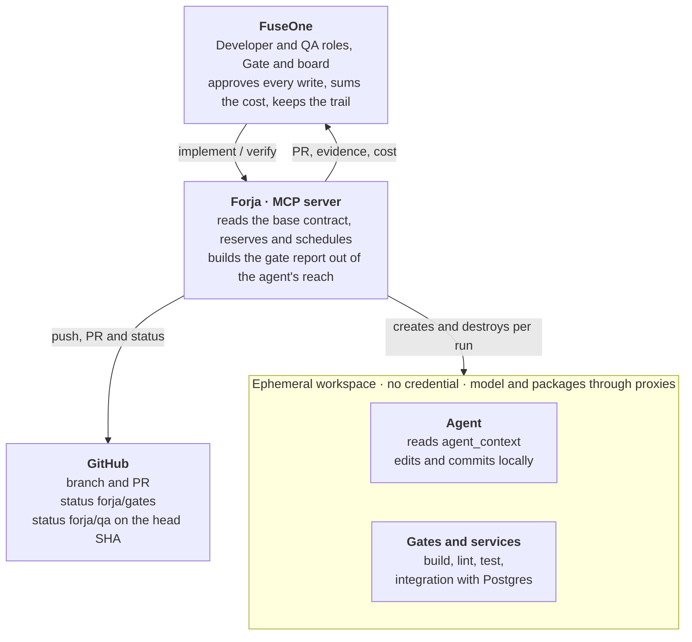
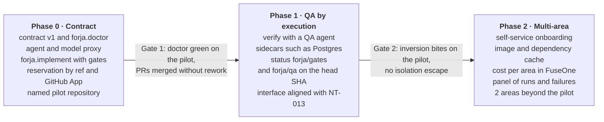

# PRD — Forja: execution runtime of the software factory

2026-10-31 · Paulo Bortolotti

> This is the Markdown version of the PRD, and the one that evolves. The
> original, in pt-BR, is [PRD.pdf](PRD.pdf) and stays as it arrived; ADRs
> written before this file cite its section names in pt-BR.

## Summary

Forja is the execution runtime of the FuseOne software factory: an MCP server
that receives "implement issue X in repository Y" and returns a PR with
verifiable evidence. Orchestration, governance and cost stay in FuseOne; Forja
only does what FuseOne does not do today — checkout, build, tests and support
services in an ephemeral, isolated environment.

**Decision asked for:** approve phase 0 as an external MCP server that FuseOne
registers like any other, on a pilot repository from another area, named
before approval. Phase 0 includes choosing and measuring the agent that runs
in the workspace. Making Forja FuseOne's official Level 2 is a later decision
and does not block phase 0.

**Pilot repository:** to be defined — a condition for approval.

## Problem and evidence

The FuseOne factory v1 orchestrates roles over the board, but no role runs
code. The only tool is GitHub's MCP server; the Developer commits only through
the API ("Level 1") and QA reads CI instead of running tests. NT-013 already
names the gap: a "coding runtime behind an MCP tool" ("Level 2"), with build
and tests before the PR, still pending.

The zen pilot showed that the factory's quality lives exactly in that
execution:

- The developer runs the repository's gates (build, lint, unit and
  integration tests with a real Postgres) and opens the PR only with exit
  code zero.
- QA inverts the implementation, whole and by half, and requires the tests to
  fail; a test that does not bite brings the delivery down.
- In the first batch, the security reviewer found a HIGH and a MEDIUM that QA
  did not see (PRs #1253 and #1254). Reading review and execution are
  complementary, not substitutes.

Today each person plugs their own machine in as a worker, with their own
account. That does not scale to other areas and gives no real isolation.

Without a shared runtime, every area that wants a factory will rebuild
worktrees, gates and card reservation on its own.

## Goals and non-goals

Goals:

1. Any repository that declares a `.forja.yaml` contract can receive
   implementation and QA by execution, with no area-specific code in Forja.
2. Every PR Forja opens carries reproducible evidence: commands run, exit
   codes, gate logs and the result of the inversion.
3. Each run runs in an ephemeral environment, with no credential and with
   egress only to the control plane's proxies, and disappears when it ends.
4. FuseOne remains the owner of scheduling, approval, cost and trail; Forja is
   just one more MCP server classified by the Gate.
5. No personal machine in the path: the identity that commits is the
   installation's GitHub App.

Non-goals:

- Orchestrating roles, moving cards or deciding priority. That belongs to
  FuseOne.
- Merging. The merge follows each area's policy in FuseOne.
- Writing each area's role prompts. They live in the area's repository.
- Guaranteeing correctness beyond what the repository's gates hold.
- Reading the production world (cluster, vault, database). Measurement stays
  with each area's own tools.

## Users and use cases

| User | Wants | How they use Forja |
|---|---|---|
| FuseOne Developer role | Implement a prepared card | Calls `forja.implement` with issue, repository and base branch; receives the PR and the evidence |
| FuseOne QA role | Try to bring the delivery down | Calls `forja.verify` on the PR; receives the verdict, the inversions run and which tests bit |
| Developer role, in the fix round | Answer a review finding | Calls `forja.implement` on the same branch with the finding as input |
| Maintainer of the area's repository | Turn the factory on in their repo | Writes `.forja.yaml`, runs `forja.doctor` and adjusts until the gates pass on `main` |
| FuseOne platform owner | Operate and charge | Sees runs, duration, compute cost and failures per repository |

The use case that decides the product is the maintainer's: if turning on a new
repository takes more than a day, adoption by other areas does not happen.

## Solution

Forja has two parts: a control plane (the MCP server, which reserves,
schedules and judges) and ephemeral workspaces (where the agent works).
Judgement stays in the control plane, out of the agent's reach.



FuseOne calls and approves; Forja creates the workspace, runs the agent and
the gates, and publishes on GitHub a status the agent cannot write.

Flow of `forja.implement`:

1. Reserves the issue under `refs/forja/claims/<n>`; if the ref exists, it
   refuses.
2. Reads `.forja.yaml` from the base branch's commit, never from the agent's
   tree, and pins that SHA in the evidence.
3. Clones the repository in the control plane and mounts the tree in the
   workspace, with the contract's image and services. The workspace receives
   no credential.
4. Runs the agent with the issue statement and the `agent_context`. It talks
   to the model and to the registries only through the control plane's
   proxies, and commits locally.
5. The control plane runs the base contract's gates over the agent's tree and
   keeps the raw log and exit code of each one.
6. A red gate goes back to the agent up to the attempt limit; once exhausted,
   the run ends as a failure with the evidence.
7. All green: the control plane pushes, opens the PR with the report and
   publishes `forja/gates` on the head SHA.
8. Destroys the workspace, releases the reservation and returns PR, evidence
   and cost to FuseOne.

`forja.verify` also runs an agent, the QA one, with its own cost. It chooses
the inversions as in the pilot: the half of the change a real regression would
undo, and the complement of what the developer declared as tested. The
inversion touches production code only; the new tests stay, and Forja runs
the base contract's gates and requires red. Reverting the whole diff does not
work: it deletes the new tests along with it and nothing goes red.

The verdict has three values:

- **Bites:** every inversion turned some gate red. Publishes `forja/qa` green.
- **Does not bite:** some inversion passed green. Publishes `forja/qa` red
  with the inversion that escaped.
- **Not verifiable:** the diff only touches excluded paths or has no
  production code. Publishes `forja/qa` neutral, never green, and the merge
  stays with a person.

## Repository contract

The `.forja.yaml` at the root is the only thing the area writes to turn Forja
on. It declares how the repository builds and proves itself; Forja guesses
nothing.

```yaml
version: 1
image: golang:1.24            # workspace base image
setup:
  - make deps
services:                      # start as ephemeral sidecars
  postgres: { image: postgres:17, env: { POSTGRES_PASSWORD: test } }
registries:                    # private dependency reads, through the proxy
  - ghcr.io/minha-org
  - npm.pkg.github.com
gates:                         # order matters; all must exit 0
  - name: build
    run: make build
  - name: lint
    run: make lint
  - name: test
    run: make test
  - name: integration
    run: make integration-test
    needs: [postgres]
verify:
  exclude: ["**/*.md", "migrations/**"]  # a diff only here = not verifiable
proof_paths:                   # proof apparatus: a change is visible and asks for a human merge
  - .forja.yaml
  - Makefile
  - scripts/**
  - "**/testdata/**"
  - "**/*_test.go"             # change or removal only; a new test does not count
human_merge_paths:             # signal to FuseOne's merge policy
  - .github/**
limits:
  wall_clock: 30m
  max_diff_lines: 400
agent_context:                 # what the agent reads before coding
  - CLAUDE.md
  - CONTRIBUTING.md
```

Contract rules:

- The control plane reads `.forja.yaml` from the base branch's commit. A
  change the agent makes to that file does not apply to the run that made it.
- Gates are the repository's own commands. Forja reads only the exit code and
  keeps the raw log; it never interprets test output.
- The base contract does not stop the agent from changing what the gates run:
  Makefile, scripts, test helpers and fixtures. Forja does not promise the
  agent cannot loosen the proof; it promises that this is visible. Every
  change in `proof_paths`, and every change or removal of an existing test,
  opens the "proof apparatus" section of the evidence and sends the PR to a
  human merge.
- `registries` lists where `setup` fetches private dependencies. The read
  credential stays in the proxy; the workspace only sees the proxy.
- `forja.doctor` runs the contract against `main` and refuses to turn the
  repository on while any gate fails there, including `setup` with the
  declared `registries`.

## Security and isolation

The agent inside the workspace is treated as untrusted code: it reads issues
and PRs written by people and executes what the repository tells it to. The
isolation belongs to the runtime, never to a rule in the prompt.

- **One workspace per run.** A new container or microVM, destroyed at the
  end, with no volume shared between runs or repositories.
- **No credential in the workspace.** Checkout, push and PR are done by the
  control plane with the GitHub App token, scoped to the repository and to the
  run's duration. Support services use disposable credentials generated at
  boot.
- **Model through a proxy.** The agent talks to the model API through a proxy
  in the control plane, which keeps the key, applies the token cap and meters
  the run's cost.
- **Private dependencies through a proxy.** The contract's `registries` go
  through a proxy with a read-only credential, per area. This widens the
  surface: the agent reads the organisation's private packages, and what
  holds exfiltration back is the egress.
- **Egress only to the proxies.** The workspace reaches the model proxy and
  the package proxy; everything else is denied and logged.
- **Push only to its own branch.** The App has no bypass permission; `main`'s
  protection still applies.
- **Signed evidence.** The gate report is generated by the control plane, out
  of the agent's reach, and published as the `forja/gates` commit status on
  the head SHA. The agent cannot forge a green gate.
- **Atomic reservation.** One run per issue, through a ref in the repository
  (`refs/forja/claims/<n>`), with a lease that expires and returns the card —
  the same mechanism measured in the pilot.

The reading security reviewer remains a FuseOne role; Forja does not replace
it.

## Integration with FuseOne

Forja comes in as an MCP server registered per area, next to GitHub's MCP
server. Nothing changes in the model of roles, board or Gate.

| Tool | Class in the Gate | Who calls | Effect |
|---|---|---|---|
| `forja.doctor` | read | maintainer, Triage | runs the contract on `main`, no push |
| `forja.plan` | read | Developer | checkout + reading of `agent_context`; returns what the agent sees, without writing |
| `forja.implement` | write | Developer | branch, commits, gates and PR with `forja/gates` |
| `forja.verify` | write | QA | QA agent, inversions and gates; publishes `forja/qa` on the head SHA |
| `forja.status` | read | any role | state, log and cost of a run |

- **Identity:** one Forja GitHub App per installation, installed only on the
  repositories turned on. The role's App in FuseOne keeps signing comments and
  reviews.
- **Approval:** `implement` and `verify` are writes; in copilot they wait for
  a person like any write. An area that wants autonomy decides that in
  FuseOne, not in Forja.
- **Cost:** Forja reports compute minutes and agent tokens per run; FuseOne
  adds them up per area and applies the per-run cap it already has.
- **Merge:** `forja/gates` and `forja/qa` are the signals that `main`'s
  ruleset and NT-013's future `merge_if_ready` can require, each pinned to its
  producer.

## Success metrics

The targets below are hypotheses to calibrate in the pilot; none has been
measured yet.

| Metric | How it is measured | Initial target |
|---|---|---|
| Time to turn a repository on | from the first `.forja.yaml` to `forja.doctor` green | ≤ 1 day |
| Forja PRs merged with no human rework on the code | merged PRs whose final diff is the agent's only | to measure in the pilot |
| Inversions that bite | % of PRs where QA saw a red test when inverting | to measure in the pilot |
| Green and wrong PR | PRs reverted or fixed within 14 days of the merge | downward trend |
| Active areas | areas with at least one run per week | 2 areas beyond the pilot in 6 months |
| Isolation escape | denied egress events originating from the agent, investigated | 0 unexplained |

## Delivery phases

Phase 0 is the decision asked for: contract, minimal runtime and the measured
choice of the agent, on a named repository from another area, before any
multi-area investment.



The phases have no dates: the duration of each comes out of what phase 0
measures. No phase starts without the previous gate green.

## Risks and open questions

The biggest risk is product, not engineering: Forja delivers only what the
repository's gates hold. In a repository with little coverage, it produces a
green and wrong PR that looks trustworthy.

| Risk | Mitigation |
|---|---|
| A repository with weak gates produces a green and wrong PR | `forja.verify` with a QA agent and a "not verifiable" verdict when there is nothing to invert; `doctor` reports coverage; a pilot chosen with average tests on purpose |
| The agent loosens a test or a gate to pass | contract read from the base; a change in `proof_paths` or to an existing test shows up in the evidence and sends the PR to a human merge |
| Private dependencies through the proxy widen what the agent reads | read-only credential, per area; egress only to the proxies; access logged per run |
| Verify with an agent makes every PR more expensive | QA cost measured separately in phase 1; per-run cap in FuseOne |
| Heavy support services (Kafka, emulators) blow the run's time | `limits.wall_clock` per repository; pre-warmed images; phase 2 handles caching |
| Compute cost with no owner | per-run report to FuseOne, which already has a budget per area |
| Overlap with a Level 2 that FuseOne may build | MCP interface aligned with NT-013 in phase 1; adoption as the official Level 2 decided later |

Open questions:

- Which agent runs in the workspace (Claude Code headless or a custom loop
  over the API) is not an open question: it is phase 0's work, because it
  decides cost, tool control and the shape of the model proxy.
- Which repository from another area enters the pilot, and who is the
  maintainer? Blocks approval.
- Workspace in a container with gVisor or in a microVM (Firecracker)? Decides
  the cost of services such as Postgres inside the run.
- Where does Forja run: in FuseOne's cluster or in a dedicated pool? Network
  isolation calls for a dedicated pool.
- Does FuseOne adopt Forja as the official Level 2? Does not block phase 0.
