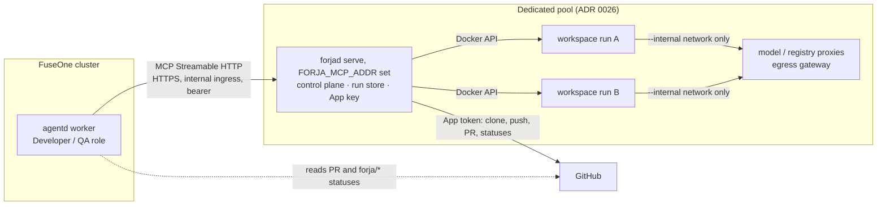

# Forja roadmap

- **Date:** 2026-11-05
- **Inputs:** [PRD](PRD.md), [ADR 0051](adr/0051-forja-as-a-separate-product.md)
  (proposed), ADRs 0026–0050, Forja issues #1–#24, and in fuseone-agents:
  #154 (software factory, Level 2), #252 (factory-mcp as its own Deployment),
  #207 (ruleset), #139 (idempotency key), NT-008, NT-011, NT-013,
  `factory/agents/developer.agent.md`.

## Where we are

The runtime is built. Issues #5–#14 and #16–#24 are closed: contract v1,
`forja.doctor`, `forja.plan`, `forja.implement` with gates, claims with a
lease, model and registry proxies, egress gateway, sidecars, limits, retries,
correction rounds, the proof apparatus, `forja.verify` with inversions,
`forja/gates` and `forja/qa`, cost per run and the operator view.

What is open is all human work: the pilot repository (#1), the agent spike
(#2), ratifying ADR 0026 (#3), the GitHub App (#4), and registering Forja in
FuseOne (#15). ADR 0051 is proposed.

Three facts in the code decide the next step:

| Fact | Where | Consequence |
|---|---|---|
| `forjad serve` speaks MCP over **stdio only** | `cmd/forjad/main.go` | FuseOne can only start Forja as a child process of its worker |
| `forja.implement` **blocks until the run ends** | `internal/mcp/implement.go` | A call lasts up to `limits.wall_clock` (30 min in the example) |
| The run store is **in memory** | `internal/runstore/memory.go` | A restart loses every run; `forja.status` cannot outlive the process |

On the FuseOne side:

| Fact | Where | Consequence |
|---|---|---|
| A stdio server is "code executed inside the worker's container, as the worker" | fuseone-agents NT-008 §4, OP-001 | Forja's control plane (Docker socket, App key, model key) would live in FuseOne's worker |
| An HTTP server is an address, reached with a bearer, headers, OAuth or a GitHub App credential; plain `http://` only on loopback | `internal/domain/mcp_credentials.go`, `internal/githubapp/tls.go` | Forja needs HTTPS and a caller credential |
| Tool calls default to a 60 s ceiling, raisable per server (`CallTimeout`) | `internal/tools/catalog.go`, `cmd/agentd/mcp.go` | A 30-minute call is possible on paper and fragile in practice |
| A worker's hold on a run is a 2-minute lease; a call interrupted mid-flight is an "unknown outcome" | NT-011, #139 | The far side must deduplicate a repeated write |
| The factory roles run on a schedule (the Developer is picked up hourly) | NT-013, `developer.agent.md` | A role can start work in one pass and read its outcome in the next |

## How FuseOne reaches an ephemeral Forja

**What is ephemeral is the workspace, not Forja.** Forja has two halves
(PRD, Architecture): a long-lived **control plane** — `forjad`, the proxies,
the GitHub App, the run store — and one **workspace** per run that exists
for the run's duration. The workspace never needs an address: the control
plane creates it, reaches it through the Docker API, and the workspace's only
network is the run's `--internal` network to the proxies (ADR 0026, 0035).
Nobody outside the control plane ever talks to a workspace.

So the question is how FuseOne reaches the **control plane**, and the answer
is the same pattern fuseone-agents just chose for factory-mcp (#252):

1. **Forja is a Deployment with an address**: `forjad serve` with
   `FORJA_MCP_ADDR` set, in the dedicated pool, behind an internal ingress
   that keeps TLS up to `forjad`. The SDK Forja already uses ships a
   Streamable HTTP handler; stdio stays for local clients (Claude Code, a
   developer's laptop), per ADR 0051 §5.
2. **FuseOne registers it as an `http` server** with a URL from the
   installation's configuration, as #252 does for factory-mcp
   (`FORJA_MCP_URL` in a catalogue recipe).
3. **The caller authenticates with a bearer.** The operator generates one
   per client, Forja stores only its SHA-256, and FuseOne sends it through
   its existing `Token` credential. Each client names the repositories it
   may reach. A NetworkPolicy admits only the ingress. Sending the role App's
   installation token instead, as factory-mcp does, is rejected in
   [ADR 0052](adr/0052-network-transport-and-caller-authentication.md)
   (Alternatives): it would put a write-capable token in Forja's control
   plane.
4. **Runs are asynchronous.** `forja.implement` and `forja.verify` return the
   `run_id` once the claim is held and the run has started; `forja.status`
   reports progress and the outcome; a new `forja.cancel` stops a run. This
   is PRD "Alignment with NT-013" item 4, made concrete.
5. **GitHub is the rendezvous, not a callback.** Forja never calls FuseOne
   (ADR 0051 §3: no triggers of its own). The Developer starts a run in one
   pass and, in a later pass, reads `forja.status` or the PR's `forja/gates`
   and `forja/qa` statuses. A role that must stay untainted reads only the
   statuses (PRD item 5).
6. **A repeated call is the same run; a different operation is not.** Two
   things the PRD's "caller key" (item 2) merged are kept apart:
   - **Correlation** is `caller_ref`: the work-item reference and the
     caller's own run id, opaque to Forja. It is recorded on the run,
     returned by `forja.status` and used to join Forja's cost to FuseOne's
     card. It **never** deduplicates. Many runs can carry the same
     `caller_ref`.
   - **Idempotency** is `idempotency_key`, chosen by the caller for one
     operation: one attempt at one tool call with one set of arguments. Its
     scope is the client (ADR 0052 §3), so two clients' keys never collide.
     The operation's identity is `(client, idempotency_key)`. Forja stores it
     with the `run_id` and a SHA-256 of the canonical arguments (tool name
     plus arguments, minus `idempotency_key` and `caller_ref`). It is stored
     in the durable run store, in the same transaction that creates the run,
     and kept as long as the run's record. The key is checked **before**
     the contract is read or a claim attempted.
   - **Same key, same arguments**: the same `run_id`, in whatever state the
     run is. No second run, no second claim. That closes the "unknown
     outcome" window of NT-011 and #139 on Forja's side.
   - **Same key, different arguments**: a tool error,
     `idempotency_key_conflict`, naming the existing `run_id`. No run, no
     claim.

   *Implementation, then correction.* The Developer calls `forja.implement`
   on issue 7 with key `K1`; run A opens the PR. The reviewer finds a
   problem, and the Developer calls `forja.implement` again with `branch`
   and `finding` and a new key `K2`; run B pushes the fix. Both carry the
   same `caller_ref`. A retry of the correction with `K2` returns B. Reusing
   `K1` for the correction is a conflict, not a silent return of A. With the
   old "work item plus caller run id" key, a correction issued from the same
   FuseOne run would have returned A and never run.

Forja's process can restart while a run is in flight, so the run store must be
durable (Postgres), and claims recovery — already in `serve` — must find the
run it is recovering.

## Milestones

Each milestone ends on something observable. The PRD's gates still apply:
nothing in phase 1 starts before Gate 1 is green.

### M0 · Decisions (human, now)

| Item | Issue |
|---|---|
| Ratify ADR 0051 and its four-surface public contract; name the release owner | PR #51 |
| Ratify ADR 0026 (Docker now, gVisor target, dedicated pool) | #3 |
| Name the pilot repository and its maintainer | #1 |
| Provision the Forja GitHub App on the pilot | #4 |
| Run the agent spike on the pilot and record the choice | #2 |
| Agree with the fuseone-agents maintainers that Forja is an external, pinned, `http` MCP server | ADR 0051, "What only the human can do" |

**Done when:** ADRs 0026 and 0051 are `accepted`, the pilot is named, the App
is installed.

### M1 · Forja has an address

| Slice | Notes |
|---|---|
| ADR 0052: network transport and caller authentication | Streamable HTTP, bearer per client, TLS up to `forjad` (ingress re-encrypts, or internal CA), which repositories a client may name, what a response may name, HTTP accepts protocol 2026-07-28 only so a dropped caller cancels its run, `Origin` allowlist (empty in the pilot), a pilot release gate (G1–G7) |
| `forjad serve` over HTTP (`FORJA_MCP_ADDR`) with caller authentication | Same tools, same schemas; stdio unchanged |
| Durable run store on Postgres | Real container in tests; claim recovery reads it |
| Health and readiness endpoints | `/healthz` and `/readyz` on the metrics listener (ADR 0052) |
| `deploy/`: Helm chart for `forjad` and the proxies in the dedicated pool | Internal ingress, NetworkPolicy, no secret in values; one replica until the durable run store lands |
| Golden tests on the tool schemas | ADR 0051 consequence |
| Reword README, `CLAUDE.md`, PRD summary and goal 4 | ADR 0051 §6 |

**Done when:** an MCP client outside the pool lists Forja's tools over HTTPS
with a valid bearer, is refused without one, and a run survives a `forjad`
restart with its state readable in `forja.status`. ADR 0052's acceptance
criteria (A, C, P and O rows) pass against the real listener.

### M2 · Long runs as a contract (before v1.0.0)

These change tool schemas. ADR 0051 freezes them under semver, so they land
**before** the first tagged major, or they cost a v2.

| Slice | PRD item |
|---|---|
| ADR 9999: asynchronous runs, `forja.cancel` and per-client idempotency ([proposed](adr/9999-async-runs-cancel-and-idempotency.md)) | 2–5 |
| `implement` and `verify` return the `run_id` at start; `status` reports the outcome | 4 |
| `forja.cancel` (a write tool) stops the run, tears down the workspace, releases the claim | 4 |
| `caller_ref` for correlation and cost (never deduplicates); `idempotency_key` per client and per operation, stored with an arguments hash in the durable store; same key and arguments return the same run, different arguments are `idempotency_key_conflict` | 2 |
| Caller budget and deadline; Forja applies the lower of the caller's and the contract's | 3 |
| `status` separates structured fields (state, exit codes, SHAs, cost) from agent-influenced ones (logs, PR text) | 5 |
| Admission: a run refused with a named error when the pool is at capacity | Back-pressure, not scheduling |
| Tag v1.0.0 | ADR 0051 §1 |

**Done when:**

- A client starts a run, disconnects, reconnects after a `forjad` restart,
  and reads the same run to its end.
- A second `implement` with the same key and arguments returns the first
  `run_id`, and no second claim commit appears in the repository. This holds
  across a `forjad` restart.
- The same key with a different `finding` returns `idempotency_key_conflict`
  naming the first `run_id`, and no run is recorded.
- Two clients using the same key on the same issue get two different
  outcomes: one run, and one held-claim error without the other's `run_id`
  (ADR 0052 §4).
- The implementation-then-correction scenario above yields two runs with one
  `caller_ref`, and `forja.status` filtered by that `caller_ref` lists both.
- `forja.cancel` stops a run that a caller started and no longer waits on.
  With asynchronous runs, a dropped request no longer cancels anything (ADR
  0052 §7). Whether HTTP then widens beyond 2026-07-28 is decided in
  [ADR 9999](adr/9999-async-runs-cancel-and-idempotency.md) §8.

### M3 · The factory uses Forja (Gate 1)

Mostly fuseone-agents work; Forja's part is #15, rewritten for HTTP.

| Slice | Repository |
|---|---|
| Catalogue recipe `forja` with URL from configuration, tools classified (`doctor`, `plan`, `status` read; `implement`, `verify`, `cancel` write) | fuseone-agents |
| Developer role: a card that needs a build calls `forja.implement` instead of `factory:needs-runtime`; a later pass reads the outcome | fuseone-agents |
| QA role: `forja.verify` on the PR's head | fuseone-agents |
| Cancelling a FuseOne run calls `forja.cancel` | fuseone-agents |
| Cost per card includes Forja's minutes and tokens, joined on `caller_ref` | fuseone-agents |
| Ruleset requires `forja/gates` and `forja/qa` pinned to the Forja App's `integration_id`, beside the role's review | fuseone-agents #207 |
| Register Forja in the pilot area's FuseOne; one card end to end in copilot mode | Forja #15 |

**Before the pilot is released:** ADR 0052's pilot release gate (G1–G7)
passes in the pilot's environment, with the real worker and the real ingress.

**Done when (PRD Gate 1):** `forja.doctor` green on the pilot, and PRs opened
by Forja merged without rework.

### M4 · QA by execution, hardened (Gate 2)

| Slice | Notes |
|---|---|
| gVisor (`runsc`) on the pool's nodes; pilot gates measured on `runc` vs `runsc` | ADR 0026 revisit criterion: > 2x |
| Inversions measured on the pilot | PRD Gate 2: "inversion bites" |
| Isolation review: no credential reachable, no egress escape | PRD Gate 2 |
| A second MCP client (Claude Code over stdio) runs the pilot | Proves ADR 0051 §2 |

**Done when (PRD Gate 2):** inversion bites on the pilot, no isolation escape.

### M5 · Multi-area (PRD phase 2)

Self-service onboarding, image and dependency cache, cost per area in
FuseOne (FuseOne's work, from Forja's per-run report), the panel of runs and
failures, two areas beyond the pilot.

## Risks

| Risk | Mitigation |
|---|---|
| The async change slips past v1.0.0 and becomes a major | M2 is ordered before the tag; golden tests catch it |
| FuseOne's 60 s call ceiling and 2-minute worker lease under a blocking call | Async runs (M2); until then, `CallTimeout` raised on the Forja entry and a short pilot `wall_clock`. A timed-out call cancels the run, since HTTP accepts 2026-07-28 only (ADR 0052 §7), so `CallTimeout` must exceed the pilot's `wall_clock` |
| A shared `forjad` serving several clients leaks one client's repository or runs to another | ADR 0052 §4: a per-client repository allowlist; `forja.status`, held-claim errors and `supersedes` name only the caller's runs; the App's installations remain the outer bound (ADR 0051 §4). What is written into a shared repository (claim refs, PR, evidence) is visible to its readers by design |
| A browser page reaches `forjad` through a user's network position | ADR 0052 §8: `Origin` allowlist, `403` before the bearer check |
| Polling `forja.status` from the agent loop costs tokens | The factory's scheduled passes poll once per pass; a role that only needs the verdict reads the commit status |
| The dedicated pool cannot run per-run `--internal` networks in the target cluster | Human check in ADR 0026; blocks M1's chart |

## Open questions

- Does MCP's long-running task support in the SDK become stable enough to
  replace `run_id` plus `status`? Not a blocker: the polling shape works with
  every client today.
- One `forjad` replica, or several over the shared Postgres store? Claims
  already serialise per issue in git; the question is the Docker host each
  replica drives.
